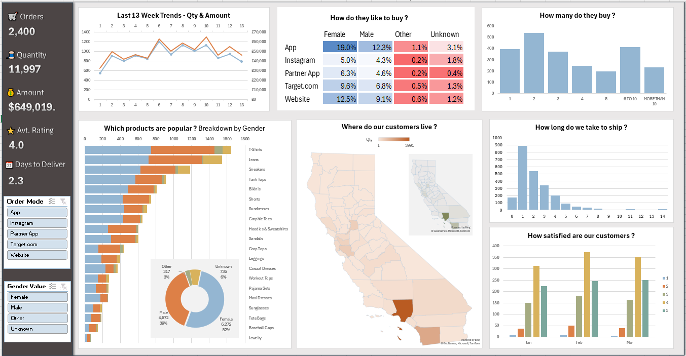

# Sales-Performance-Customer-Insights-Dashboard-Excel

## 📌 Project Overview

An interactive sales analytics dashboard built in Microsoft Excel to explore sales performance, customer purchasing behavior, product popularity, geographical distribution, customer satisfaction and shipping efficiency.

## 🖥️ Dashboard Preview

## 🎯 Project Objectives

The goal of this project is to analyze sales data and identify patterns in customer behavior, product demand, purchasing channels and order fulfillment.

The dashboard provides a consolidated view of business performance and helps answer key questions about sales trends and customer preferences.

## 🔍 Business Questions

The dashboard explores the following business questions:

- **Sales Trends:** How have order quantities and sales amounts changed over the last 13 weeks?
- **Purchasing Channels:** Which channels do customers use to place their orders?
- **Purchase Volume:** How many items do customers typically buy?
- **Product Popularity:** Which products generate the highest sales volumes, and how do purchasing patterns differ by gender?
- **Customer Demographics:** What is the gender distribution of customers?
- **Geographical Distribution:** Where are customers located?
- **Shipping Performance:** How many days does it take to ship orders?
- **Customer Satisfaction:** How do customer ratings vary over time?

## 📊 Dashboard Features

### 1. Sales Trends
A 13-week trend analysis comparing order quantities and sales amounts to identify changes in sales performance over time.

### 2. Purchasing Channels
A breakdown of customer purchasing preferences across five channels:

- App
- Instagram
- Partner App
- Target.com
- Website

The analysis also compares channel preferences across customer gender categories.

### 3. Purchase Quantity Analysis
A visualization showing how many products customers purchase per order, from individual items to larger quantities.

### 4. Product Popularity
A horizontal stacked bar chart comparing product quantities across customer gender categories, helping identify popular products and differences in purchasing behavior.

### 5. Customer Demographics
A gender distribution chart showing the proportion of customers categorized as Female, Male, Other, and Unknown.

### 6. Geographical Analysis
A map-based visualization of customer distribution across California, providing insight into the geographical concentration of customers.

### 7. Shipping Performance
A distribution chart showing the number of days required to ship orders, helping assess fulfillment speed and identify longer delivery times.

### 8. Customer Satisfaction
A monthly breakdown of customer ratings, allowing comparisons of satisfaction levels across January, February and March.

## 📂 Dataset Overview

The dataset contains transaction-level information about orders, products, customers and shipping.

Key fields include:

| Column | Description |
|---|---|
| TX ID | Unique transaction identifier |
| Product | Product purchased |
| Quantity | Number of units purchased |
| Unit Price | Price per unit |
| Amount | Total transaction amount |
| Order Date | Date the order was placed |
| Ship Date | Date the order was shipped |
| Customer Gender | Original customer gender field |
| Order Mode | Purchasing channel |
| Rating C | Customer rating |
| State | Customer's state |
| County | Customer's county |
| Days to Deliver | Shipping or delivery duration, as defined in the dataset |
| Weeknum | Week number for trend analysis |
| Gender Value | Standardized gender category |

## 🎛️ Interactivity

The dashboard includes interactive slicers that allow users to filter the analysis by:

- **Order Mode** – Compare purchasing channels.
- **Gender Value** – Explore differences between customer gender categories.

## 💡 Key Metrics

- **$649K in total sales amount** across 2,400 orders.
- **11,997 units sold**, providing an overview of product demand.
- **4.0 average customer rating**, indicating generally positive customer feedback.
- **2.3 average days to deliver**, offering a high-level view of fulfillment performance.

## 🚀 How to Use

1. Clone or download this repository.
2. Open the Excel workbook in Microsoft Excel.
3. Navigate to the dashboard worksheet.
4. Use the slicers to filter results by order mode or gender.
5. Explore the charts and KPIs to investigate sales performance and customer behavior.

# Dominika Schabowska
